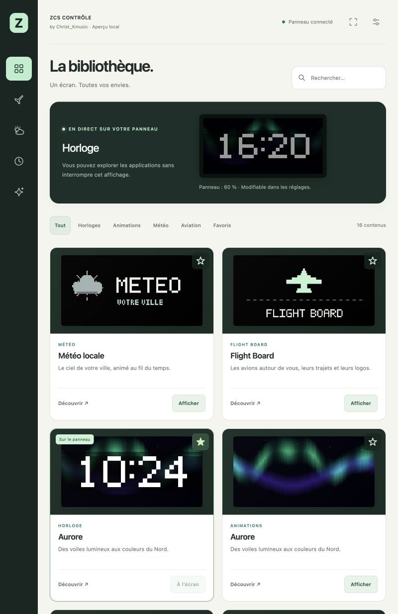

# ZCS CONTRÔLE · V4.1.3

**by Christ_Kmusic** — une bibliothèque de contenus pour votre panneau LED, pilotée depuis une tablette ou un téléphone.



## Mises à jour complètes

Depuis la V4.1.3, l’application prépare et vérifie l’interface associée avant d’envoyer le programme. Le panneau contrôle que cette interface correspond à l’empreinte intégrée au nouveau programme avant de l’activer. L’interface actuelle est conservée dans un autre emplacement ; une préparation interrompue ne la remplace pas. La bonne interface est sélectionnée au redémarrage, puis la tablette vérifie le résultat et rouvre l’application.

Les fichiers d’interface sont identifiés par leur SHA-256 dans leur adresse. Le programme, son interface et le catalogue sont publiés dans le même commit. Le script public `tools/publish_release.py` refuse d’écraser une version existante ou d’associer des fichiers incompatibles. Les mises à jour manuelles passent aussi par ces vérifications. La première transition depuis une ancienne version récupère automatiquement son interface si Internet est disponible.

## La bibliothèque

La V4 repense entièrement l’interface : navigation latérale, espace clair, aperçu du panneau, recherche et catégories. La bibliothèque regroupe Flight Board, Météo, sept horloges, sept animations, les messages, le minuteur et les scores. Le Store permet d’ajouter des contenus. Les étoiles créent une collection de favoris enregistrée dans le navigateur de cette tablette.

**Découvrir** ouvre un aperçu sans interrompre le panneau. **Afficher** active le contenu et son ambiance ensemble. Les favoris, la recherche et les aperçus n’envoient aucune commande au panneau. Un choix consulté pendant une requête en cours reste conservé.

- **Flight Board** : radar, vols proches, indicatif, compagnie, logo, type d’appareil, trajet lorsqu’il est disponible, distance, vitesse et altitude. Filtres combinables par logo disponible, compagnie, type et altitude maximale. Le trajet reste indicatif et peut être absent lorsque sa cohérence n’est pas confirmée.
- **Météo** : température, vent et illustration animée selon les conditions. Le dernier relevé est daté ; une donnée indisponible n’est pas remplacée par une valeur inventée.
- **Horloge de chevet** : date, heure et météo locale, avec un affichage adapté à la nuit.
- **Horloge et Animations** : Aurore, Océan, Hyperespace, Lave, Étoiles, Matrix et Minimal / Écran noir. Les animations sont générées localement, sans téléchargement de vidéo.
- **Message** : texte personnalisé et couleur, avec aperçu avant affichage.
- **Minuteur** : compte à rebours, démarrer, mettre en pause, reprendre et réinitialiser. Après un redémarrage, il reprend en pause depuis le dernier état enregistré.
- **Scores** : choix du match par compétition et date — Ligue 1, Premier League et Ligue des champions. Le panneau suit le match via ESPN toutes les minutes.
- **Store** : huit contenus initiaux : Ville néon, Voyage cosmique, Pluie à la fenêtre, Feu de camp, Chat pixel, Orbite arcade, Bienvenue et Focus 25 minutes. Un téléchargement ajoute le contenu à la bibliothèque sans modifier l’affichage en cours. Jusqu’à 13 contenus installés ; un contenu actif doit être quitté avant sa suppression.
- **Polices du panneau** : Pixel classique, Moderne, Numérique, Arcade et Compacte. Choix indépendant pour Aviation, Horloge, Météo, Message, Minuteur et Scores, avec un aperçu en vrais pixels avant enregistrement. Les petits libellés gardent leur tracé compact pour rester lisibles.
- **Horloge par défaut** : animation au choix dans Réglages → Horloge et nuit, mémorisée après redémarrage et utilisée également sans vol.
- **Réglages** : luminosités de jour et de nuit immédiates et mémorisées, horaires de nuit, fuseau horaire, lieu, Wi-Fi et mise à jour depuis la tablette.

Après sa première installation, l’interface fonctionne depuis la mémoire du panneau, sans police ou bibliothèque distante. Le téléchargement de nouveaux contenus et des logos haute définition nécessite Internet sur la tablette. Les animations, messages et contenus déjà installés restent disponibles hors ligne. Elle est adaptée notamment aux tablettes **800 × 1340** et **1340 × 800**. L’animation de l’aperçu respecte la préférence de réduction des mouvements du navigateur.

## Matériel de cette version

Le binaire fourni est destiné à la **Waveshare ESP32-S3-RGB-Matrix avec un panneau HUB75 K716 128 × 64, balayage 1/32**. La correspondance des couleurs est calibrée pour le panneau K716-128X64-32S V3.3 validé sur ce projet. Pour un câblage ou un panneau différent, adapter le pilote puis compiler les sources.

| Signaux | Broches |
| --- | --- |
| R1 / G1 / B1 | 5 / 6 / 4 |
| R2 / G2 / B2 | 15 / 16 / 7 |
| A / B / C / D / E | 18 / 8 / 3 / 42 / 9 |
| CLK / LAT / OE | 41 / 40 / 2 |

La luminosité est réglable de 10 à 100 %. Pendant la plage de nuit, le panneau applique le minimum des luminosités de jour et de nuit, ou s’éteint si la veille est choisie. Changer le curseur nocturne en journée prépare la prochaine nuit. L’activation de la plage et ses horaires nécessitent **Enregistrer les réglages**.

## Installer la V4

Sur une carte déjà configurée et compatible : ouvrir **http://flightboard.local/**, puis **Réglages → Connexion et mises à jour → Mettre à jour le programme → Rechercher une mise à jour**. Vérifier la compatibilité matérielle ci-dessus et lancer l’installation. La carte redémarre. Recharger la page puis choisir **Télécharger et installer** sur l’écran « Finaliser ZCS Contrôle ». Le fichier exact de l’interface est vérifié puis enregistré dans la mémoire du panneau. Pour les logos de la tablette, utiliser **Restaurer les logos** dans la bibliothèque ; les logos du panneau sont déjà disponibles.

Les réglages, le Wi-Fi, les lieux favoris et la cadence radar restent en mémoire. La mise à jour ne change pas les partitions. Le téléchargement passe par HTTPS, puis sa taille et son SHA-256 sont vérifiés avant l’installation sur la partition inactive.

- [Programme V4.1.3](releases/ZCS-Control-4.1.3-Waveshare-K716.ino.bin)
- [Empreinte SHA-256](releases/ZCS-Control-4.1.3-Waveshare-K716.ino.bin.sha256)
- [Interface V4.1.3 pour installation hors ligne](store/zcs-web-4.1.3.bin)
- [Empreinte et provenance de l’interface](store/zcs-web-4.1.3.json)
- [Catalogue du Store](store/catalog.json)
- [Manifeste de mise à jour](latest.json)
- [Sources complètes](src/FlightBoard_V1_4)
- [Inventaire SHA-256 des sources](source-manifest.json)

Sans Internet, télécharger auparavant le fichier d’interface ci-dessus, puis choisir **Installer depuis un fichier** sur la page de finalisation. Cette page reste embarquée et permet aussi de configurer le Wi-Fi ou d’envoyer un programme compatible, même si l’interface complète manque ou ne correspond plus à la version installée.

Le fichier `.ino.bin` est l’application OTA. Ne pas envoyer un bootloader ou une image « merged » par le formulaire de mise à jour. Pour une première installation USB, compiler et téléverser le sketch avec Arduino IDE ou Arduino CLI. Le programme public ne contient aucun identifiant Wi-Fi ; la configuration se fait depuis le réseau de secours de la carte. Au premier démarrage, ouvrir le moniteur série USB à **115200 bauds** pour lire le réseau `FlightBoard-XXXX` et sa « Clé de secours », rejoindre ce réseau puis ouvrir **http://192.168.4.1/** pour choisir le Wi-Fi. Garder cette clé privée.

## Compiler les sources

Le dossier du sketch conserve le nom `FlightBoard_V1_4` pour la compatibilité Arduino ; la version du programme est bien **4.1.3**.

Dépendances utilisées : cœur **ESP32 3.3.12**, **ArduinoJson 7.4.3**. Le pilote HUB75 Waveshare est embarqué et épinglé sous `assets/vendor/waveshare-hub75`. Les fichiers générés sont inclus : Node et Python ne sont nécessaires que pour régénérer les ressources après une modification.

```sh
cd src/FlightBoard_V1_4
arduino-cli core update-index --additional-urls https://espressif.github.io/arduino-esp32/package_esp32_index.json
arduino-cli core install esp32:esp32@3.3.12 --additional-urls https://espressif.github.io/arduino-esp32/package_esp32_index.json
arduino-cli lib install ArduinoJson@7.4.3
arduino-cli compile --fqbn 'esp32:esp32:esp32s3:USBMode=hwcdc,CDCOnBoot=cdc' --build-path /tmp/zcs-control-build .
```

Après modification de l’interface ou des logos, utiliser Node.js 18 ou supérieur et Python 3.10 ou supérieur, de préférence dans un environnement virtuel, avec les dépendances exactes :

```sh
npm ci --ignore-scripts
python3 -m pip install Pillow==12.3.0 zopfli==0.2.3.post1
python3 build_assets.py
```

`FlightBoardWeb.h` reste lisible. La génération compacte seulement les espaces et les identifiants JavaScript locaux avec **esbuild 0.28.2**, puis compresse l’interface avec Zopfli. Le HTML, le CSS, les propriétés et les références externes sont conservés ; le code applicatif est isolé dans une fonction pour compacter ses identifiants ; aucune compilation ne s’effectue sur la carte. `--hash-only` fonctionne avec la bibliothèque standard Python. La génération produit `assets/zcs-web.bin/json`, le pack `assets/zcs-logos.bin/json`, les empreintes compilées et `ZcsBootstrap.h` (interface de secours de moins de 4 Kio gzip). Ces ressources doivent être publiées avec le programme qui leur correspond ; les URL du pack web sont versionnées et leurs octets ne doivent jamais être remplacés après publication.

Pour un binaire public, compiler une copie du sketch **sans `Secrets.h`**. `tools/prepare_release.py` contrôle la provenance de la compilation et refuse ce fichier par son nom, sans lire son contenu. Le dossier de compilation publique doit contenir uniquement les fichiers racine `.h`, `.cpp` et `.ino` (sauf `Secrets.h`), ainsi que `assets/vendor/waveshare-hub75`, `assets/bootstrap.html`, `assets/zcs-web.bin` et `assets/zcs-web.json` ; les tests et outils restent dans le dépôt source. Ne pas ajouter d’identifiants privés au dépôt.

## Vérifier

```sh
npm ci --ignore-scripts
for suite in tests/ui/*.cjs; do node "$suite"; done
python3 tests/host/run_tests.py . --arduino-json /chemin/vers/ArduinoJson/src
node tests/host/test_panel_parity.cjs
python3 -B tests/release/test_prepare_release.py -v
python3 -B tests/store/run_tests.py
python3 tests/test_logo_images.py
```

Les tests du stockage simulent des coupures, des erreurs de lecture/écriture et de la corruption ; la banque précédente reste exploitable si une nouvelle installation est interrompue. L’initialisation n’efface jamais automatiquement une partition inconnue. Les tests de la page de secours vérifient téléchargement, import local, limites de taille, SHA-256, Wi-Fi et OTA.

Les tests couvrent la bibliothèque, les réponses tardives, les favoris, les aperçus indépendants, les curseurs de luminosité, l’aviation, les mises à jour et le programme embarqué. La comparaison C++/JavaScript vérifie 397 scènes du panneau, pixel par pixel. Le rendu optique et le câblage nécessitent toujours une vérification sur le matériel correspondant.

## Données et ressources

- Les positions viennent d’ADSB.lol ; les trajets indicatifs sont recherchés via VRS. Le radar mémorise le rythme qui fonctionne et augmente son délai lors d’une limitation HTTP 429. Les nouvelles recherches sont suspendues hors aviation.
- La météo utilise Open-Meteo avec les coordonnées du lieu arrondies à deux décimales, environ 1 km. Elle est relevée toutes les 15 minutes lorsque le module est actif. Un relevé de plus de 30 minutes est signalé comme ancien.
- Les scores proviennent du service public ESPN. Une donnée en erreur ou âgée d’au moins trois minutes est signalée comme ancienne ; le service peut être indisponible ou changer. La recherche de matchs passe par la tablette, puis seul le match choisi est suivi par le panneau.
- Les logos conservent leurs sources, références et licences dans [assets](src/FlightBoard_V1_4/assets). Les marques restent la propriété de leurs titulaires. Les licences des composants embarqués sont conservées dans leurs dossiers `vendor`.

Les contenus du Store sont des données JSON (pixels, messages ou minuteurs), jamais du code à exécuter. Le panneau vérifie leur taille, leur SHA-256 et leur format. Les fichiers d’interface et de logos possèdent en plus une empreinte attendue compilée dans chaque programme. Le stockage utilise deux banques dans la partition de données existante ; les réglages et les deux partitions OTA restent séparés. Les playlists automatiques ne sont pas incluses dans cette version.
